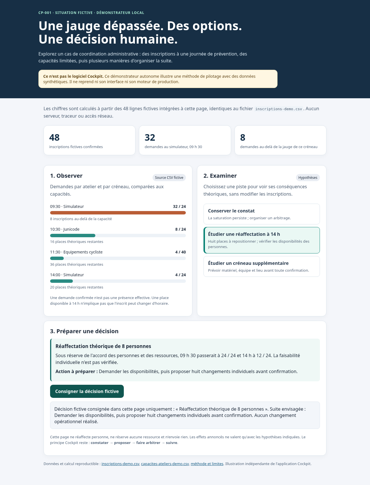

# CP-001 — Un cas concret d'arbitrage administratif

**Statut : démonstrateur illustratif autonome, et non version du logiciel Cockpit.**

L'objectif est de donner un exemple vérifiable à des agents publics ou à des développeurs qui souhaitent discuter de l'approche Cockpit : **source → constat → risque → options → décision humaine → action**.



*Capture du démonstrateur illustratif autonome, **pas de l'interface Cockpit**.*

## Essayer en deux minutes

1. Télécharger le dossier en ZIP, ou récupérer les fichiers du dépôt.
2. Ouvrir `parcours.html` dans un navigateur, même hors connexion.
3. Observer les écarts entre inscriptions et capacités ; sélectionner une hypothèse d'arbitrage.
4. Cliquer sur « Consigner la décision fictive » : la trace reste dans la page, sans action sur les données ni sauvegarde persistante.

La page HTML n'utilise aucune bibliothèque externe et ne contacte aucun serveur. Elle contient une copie exacte des deux CSV pour s'ouvrir directement depuis le disque. **Elle ne charge pas l'application ni le moteur de Cockpit.**

## Données et constat

- `inscriptions-demo.csv` : 48 identifiants fictifs (P001 à P048), aucun nom, courriel ni numéro réel.
- `capacites-ateliers-demo.csv` : quatre jauges théoriques.
- Simulateur 09 h 30 : **32 demandes / 24 places**, soit **8 inscriptions excédentaires**.
- Simulateur 14 h : **4 demandes / 24 places**, donc 20 places théoriques.
- Une réaffectation de huit inscriptions vers 14 h est *mathématiquement envisageable*, mais les disponibilités individuelles et les ressources ne sont pas vérifiées.

Le jeu de données est fictif et issu d'un scénario de démonstration conçu pour Cockpit. **Ni code métier, ni dossiers d'agents, ni données utilisateurs réelles ne sont diffusés ici.**

## Refaire le calcul indépendamment

Avec Python 3 et la seule bibliothèque standard, depuis la racine du dépôt :

```sh
python exemples/cp001/analyser.py
python -m unittest discover -s exemples/cp001 -p "test_*.py" -v
```

Le script affiche les jauges et excédents ; les tests vérifient aussi le refus des doublons, d'une capacité manquante et d'une capacité invalide.

## Ce que la démonstration prouve, et ne prouve pas

**Elle prouve :** un jeu synthétique contrôlable, un calcul reproductible et une présentation interactive d'options qui ne prennent aucune décision à la place de l'agent.

**Elle ne prouve pas :** la compilation de Cockpit, le raccordement de ses imports, risques, décisions et plannings, son ergonomie réelle ou l'isolation complète de l'édition Administration. Pour démontrer l'application elle-même, une recette Windows avec données fictives et captures **réelles** sera nécessaire avant publication.

La page et le script sont des *exemples pédagogiques indépendants*, dont la publication ne constitue pas une ouverture sous licence libre du code applicatif Cockpit. Le régime de réutilisation du projet reste à clarifier avant toute distribution du logiciel.

**Question à la communauté :** Quelles contraintes humaines, matérielles et réglementaires devraient être documentées avant de proposer un changement de créneau ?
